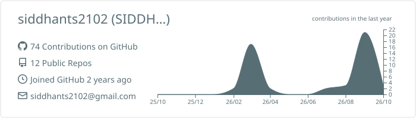
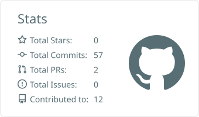

# Hi 👋, I'm Siddhant Sharma
**AI/ML & Backend Engineer focused on Generative AI, Agentic Workflows, and Scalable Backend Development**

### 🚀 About Me
- 🎓 Final-Year Bachelor of Technology in Computer Engineering at ZHCET, Aligarh Muslim University (AMU).
- 
- 💻 Specializing in building intelligent, multi-agent systems and robust server-side architectures.
- 
- ⚙️ Proficient in designing secure RESTful APIs, managing databases, and deploying applications with FastAPI.
- 
- 🔐 Built production-oriented systems including:
  - **AI Video Generation Platform:** Full-stack app with prompt enhancement, lip-syncing, sound synthesis, and Supabase JWT auth.
  - **AI Blog Writing Agent:** Multi-agent orchestration using LangGraph/LangChain with interactive Human-in-the-Loop. checkpoints.
  - **Smart Healthcare System:** Unified platform featuring GenAI diagnostics, custom OCR/NER, CNN models, and a MediaPipe pose estimator.
- 🧠 Achievements & Interests: 
  - Completed the 160 Days DSA Challenge on GeeksforGeeks
  - Passionate about Vector Embeddings, RAG, and fine-tuning LLMs.
- 📫 Reach me at: siddhants2102@gmail.com

### 🌐 Connect with me:

### 🛠️ Languages and Tools:
- **Languages:** Python, C/C++, Java, SQL.
- **Core AI & GenAI:** Machine Learning, Deep Learning, NLP, RAG, Agentic Workflows, MCP, Prompt Engineering.
- **Frameworks & Libraries:** LangChain, LangGraph, LangSmith, TensorFlow, PyTorch, Scikit-Learn, NumPy, Pandas, FastAPI.
- **Databases:** ChromaDB, FAISS, Pinecone, MySQL, MongoDB.
- **Tools & Deployment:** Git/GitHub, Docker, Vercel, Render.

---

### 📊 GitHub Analytics

  

 

  
  

 

  

